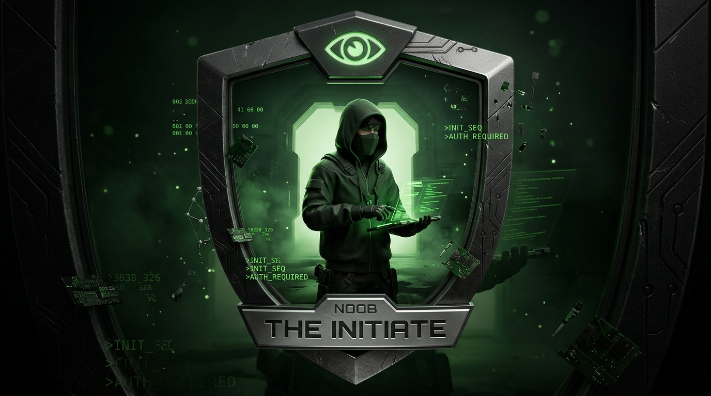

# Cloudbreak Pipeline -- Bucket



**Difficulty: Noob tier.** The first box of **Cloudbreak Pipeline**, a
new 8-tier red-team game -- a separate ladder from
[The Halcyon Protocol](https://github.com/A3lxq?tab=repositories&q=synnefo-)
series, telling one escalating cloud-native/DevOps red-team engagement
against the fictional "Nimbus Freight" logistics startup, climbing
toward a full Kubernetes cluster compromise in later tiers.

This box: object-storage bucket enumeration, discovering a second
unlisted-but-public bucket, a leaked cloud storage credential, a
private bucket, SSH foothold via credential reuse, and a
sudo/GTFOBins (`tar`) privilege escalation. 10 real flags, no decoys.

The object storage is a small hand-rolled S3-compatible server
(`docker/s3server.py`) -- MinIO's community server/client binaries
were found to have been pulled from distribution entirely mid-project
(`dl.min.io` now returns `410 Gone`), so this box doesn't depend on it.

## Running it

This box is built and provisioned per-team by
[ctf-orchestrator](https://github.com/A3lxq/CTF-orchestrator) (Docker
or Kubernetes backend) -- this repo holds the box's own source
(`docker/Dockerfile`, `docker/entrypoint.sh`, the per-team
`CTF_SECRET`/HMAC flag scheme) which the orchestrator pulls in as a git
submodule under its own `boxes-src/cloudbreak-noob-bucket/`.

To build and run it standalone for testing:
```bash
cd docker
docker build -t ctf-boxes/cloudbreak-noob-bucket:latest .
docker run -d -e CTF_SECRET=<any-string> -p 22:22 -p 9000:9000 \
    ctf-boxes/cloudbreak-noob-bucket:latest
```
